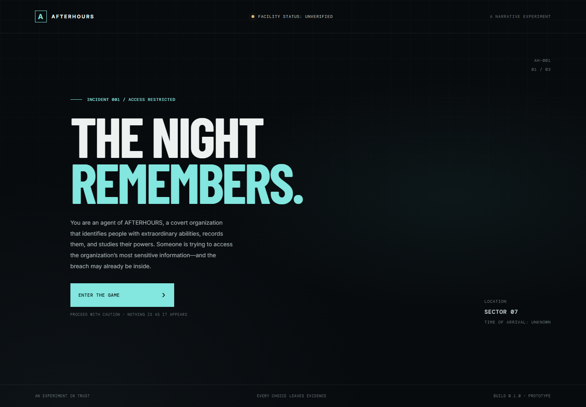

# AFTERHOURS

A supernatural investigation at a remote lighthouse facility, where an impossible access record points to an intruder.<br>
Strands Decider 2B shapes pacing from player behavior; deterministic game rules keep puzzles and evidence under game control.



## How Decider is used

1. The frontend sends verified room context and player telemetry to FastAPI, which asks Strands Decider 2B to choose **HINT**, **RAISE_TENSION**, or **WAIT**.
2. The frontend validates the action; a hint uses authored clues, tension requests a separate Bedrock narration, and wait has no effect.
3. Deterministic game logic alone checks puzzle answers, records evidence, and advances the episode.

## Quickstart

After the one-time setup in [the developer guide](docs/DEVELOPMENT.md), open three PowerShell terminals from the project root:

1. Start the local Decider on a machine with enough memory. The checkpoint must already be cached.

   ```powershell
   $checkpoint = Join-Path $env:HF_HUB_CACHE 'models--StrandsAgents--strands-decider-2B-hobson-v19\snapshots\bb282d786bc251fd4e3068de3ada9ddbb38127cd'; .\backend\.venv\Scripts\strands-decider.exe serve $checkpoint --host 127.0.0.1 --port 8001 --device cpu --model-name strands-decider-2B-hobson-v19
   ```

2. Start the API from the backend directory.

   ```powershell
   Set-Location backend; .\.venv\Scripts\python.exe -m uvicorn main:app --host 127.0.0.1 --port 8000
   ```

3. Start the frontend from the frontend directory, then open http://127.0.0.1:5173.

   ```powershell
   Set-Location frontend; npm run dev -- --host 127.0.0.1
   ```

The local CPU Decider is memory-intensive; the developer guide describes hardware and model setup. Live Bedrock narration also requires AWS credentials and model access.

## The game

Investigate the lighthouse facility, inspect records and surveillance, and find five authored differences in the records comparison. Valid puzzle targets, evidence collection, and room progression are controlled by application logic. Behavior-triggered interventions can offer a clue, request a tension beat, or wait while the player continues.

## Architecture and reusable pattern

The React frontend contains the game screens, state, puzzles, and action effects. The FastAPI backend bridges decision and narration requests. Strands Decider 2B selects from a caller-provided action set; Amazon Bedrock generates narration from verified game facts.

The reusable constrained decision pattern is implemented in [frontend/src/game/director.js](frontend/src/game/director.js), explained in [frontend/src/game/DIRECTOR_PATTERN.md](frontend/src/game/DIRECTOR_PATTERN.md), and covered by [frontend/src/game/director.test.js](frontend/src/game/director.test.js). The model chooses an intervention; the application separately validates it and applies any game effect.

See the [developer guide](docs/DEVELOPMENT.md) for architecture details, configuration, installation, tests, and the repository map.

## Project links

- [Public GitHub repository](https://github.com/SnehaGaneshBhat/AfterHours)
- [AWS Agent Experience Hackathon](https://builder.aws.com/build/hackathons/4f50957c-1d08-37ab-b11c-97516b9adeb4/agent-experience-hackathon?tab=about)

## License and artwork

Original project source code is licensed under [Zero-Clause BSD (0BSD)](LICENSE), an OSI-approved license. The game’s visual artwork was generated using OpenAI’s image-generation tools for this project. The source-code license does not automatically determine the licensing of every asset. Third-party fonts, libraries, and model weights retain their respective terms.
