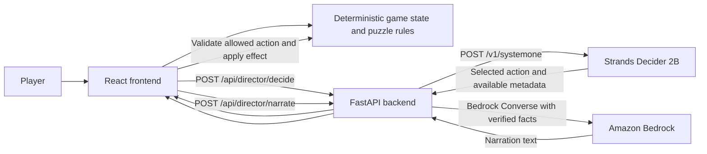

# Developer guide

This guide describes the implemented game, service boundaries, local setup, configuration, validation, and repository layout.

## Game flow

The player enters the AFTERHOURS lighthouse facility, investigates the gates and security terminal, proceeds through the lighthouse and surveillance room, and compares two records-centre images. Five authored targets in the altered image count as findings. After the comparison, the laboratory sequence presents the collected evidence and episode conclusion.

The records puzzle can request a director decision after repeated incorrect clicks or sustained inactivity, and the player can request one manually. A decision request does not pause puzzle play.

| Action | Application effect |
| --- | --- |
| HINT | Uses game-owned clue progression or highlights the next authored, unfound records hotspot. |
| RAISE_TENSION | Requests a separate Bedrock tension narration without revealing an unfound records difference. |
| WAIT | Makes no gameplay or narration change. |

The game checks puzzle answers, counts a finding once, records evidence, and advances rooms. Neither AI service determines puzzle correctness or directly awards evidence.

## Architecture

- **React and Vite frontend:** renders the game and owns player-facing state, puzzle checks, telemetry, action validation, and action effects.
- **FastAPI backend:** validates requests, forwards bounded decision requests to the local Decider endpoint, and calls Bedrock Converse for narrative generation.
- **Strands Decider 2B:** selects among allowed actions using the supplied state and telemetry. It does not decide puzzle correctness.
- **Amazon Bedrock:** generates narration using verified event facts and recent narration for continuity. Its output does not change authoritative game state.



The backend is in [backend/main.py](../backend/main.py). Its default Decider URL is http://127.0.0.1:8001/v1/systemone; FastAPI listens on port 8000. The default Bedrock model ID is amazon.nova-lite-v1:0, and the Decider model name is strands-decider-2B-hobson-v19.

Frontend game state and transitions live in frontend/src/game/. The API bridge is used from the React application and game components.

## Reusable constrained decision pattern

The pattern is labelled **REUSABLE CONSTRAINED DIRECTOR PATTERN** in [frontend/src/game/director.js](../frontend/src/game/director.js). Its usage note is [frontend/src/game/DIRECTOR_PATTERN.md](../frontend/src/game/DIRECTOR_PATTERN.md), with focused tests in [frontend/src/game/director.test.js](../frontend/src/game/director.test.js).

It accepts verified room facts, recent narration, player telemetry, and an allowlist. The request module calls the existing backend route, checks the returned action against the caller’s allowed set, and keeps response metadata only when it is present and valid. Timeouts, cancellation, network failures, and malformed responses return distinct outcomes.

A typical context includes the current room, verified facts such as “2 of 5 differences found,” and telemetry such as misclick count, inactivity, elapsed time since a successful find, and remaining differences. The response exposes an accepted action and any returned model, source, confidence, probabilities, and service latency metadata; fields not supplied by the service remain absent. Client round-trip time is reported separately.

The consuming application maps the accepted action to its own effect. HINT selects an authored clue, RAISE_TENSION requests a Bedrock narration event, and WAIT is inert. This separation lets another application reuse bounded action selection without delegating authoritative state changes to the model. This project uses the HTTP integration; it does not include an InterventionHandler implementation.

## Technology

| Technology | Role |
| --- | --- |
| React 19 | Interactive game screens |
| Vite 8 | Frontend development and production build |
| JavaScript and CSS | Game state, UI behavior, and presentation |
| Python 3.10+ | Backend runtime |
| FastAPI and Pydantic | HTTP routes and request/response validation |
| boto3 | Amazon Bedrock Runtime Converse call |
| Strands Decider 2B | Constrained intervention selection |
| Amazon Bedrock | Evidence-grounded narrative generation |
| Node.js and npm | Frontend scripts and dependency management |

Frontend dependencies and scripts are declared in frontend/package.json; exact resolutions are in frontend/package-lock.json. Backend API pins are in backend/requirements.txt; the separate, large model-server dependency set is in backend/requirements-decider.txt.

## Prerequisites and limitations

For the API and frontend, use Python 3.10 or newer, Node.js 20.19+ or 22.12+, npm, and Python’s venv module. The frontend uses the committed npm lockfile.

Live narrative generation requires AWS credentials available through boto3’s standard credential chain, a region with access to the configured Bedrock model, and permission to invoke it. A live director decision requires a reachable Strands Decider 2B server with its complete checkpoint and base model provisioned separately. Model weights are not included in this repository.

The installed Decider CPU path converts the model torso to FP32. Its source estimates about 7 GiB for torso weights alone, before the readout, adapters, Python/PyTorch runtime, and operating system. A laptop with 8 GB RAM is not suitable for comfortably running this local CPU server. Use a higher-memory system or a supported accelerator. No quantization or reduced-memory loading mode is documented by the installed package used for this project.

Browser request cancellation stops the browser from waiting; it does not necessarily stop backend or model work already in progress. Confidence and probabilities are shown only if the service returns them. The game and API are a local prototype without user authentication or a database. Keep the unauthenticated local Decider bound to 127.0.0.1.

## Configuration

| Variable | Service | Required? | Purpose and example |
| --- | --- | --- | --- |
| VITE_API_BASE_URL | Frontend | Optional | Browser-visible backend origin; defaults to http://127.0.0.1:8000. Never put credentials here. |
| AWS_REGION | Backend | Optional | Bedrock region; defaults to us-east-1. |
| BEDROCK_MODEL_ID | Backend | Optional | Bedrock model; defaults to amazon.nova-lite-v1:0. |
| DECIDER_URL | Backend | Optional | Decider endpoint; defaults to http://127.0.0.1:8001/v1/systemone. |
| FRONTEND_ORIGINS | Backend | Optional | Comma-separated browser origins; defaults to http://localhost:5173,http://127.0.0.1:5173. |
| AWS_PROFILE or another boto3 credential provider | Backend | Required for live Bedrock | Example: set AWS_PROFILE to your configured profile. Use SSO, a local profile, an assigned role, or another supported provider. Keep credentials outside this repository. |
| HF_HOME, HF_HUB_CACHE, HF_HUB_OFFLINE | Decider process | Optional | Cache and offline-download controls. The application itself does not read these variables. |

Examples are in frontend/.env.example and backend/.env.example. Vite loads frontend/.env.local; copy the example there if changing the browser API origin. FastAPI reads process environment variables directly and does not automatically load .env files. Set backend values in the same PowerShell session as Uvicorn. Variables beginning with VITE_ are included in browser code and are not secret.

## Installation and launch (PowerShell)

The API and frontend dependencies can be installed without loading the local model.

1. Clone the repository:

   ```powershell
   git clone https://github.com/SnehaGaneshBhat/AfterHours.git
   Set-Location AfterHours
   ```

2. Install frontend dependencies:

   ```powershell
   npm ci --prefix frontend
   ```

3. Create a backend virtual environment and install the API dependencies:

   ```powershell
   python -m venv backend\.venv
   .\backend\.venv\Scripts\python.exe -m pip install -r backend\requirements.txt
   ```

4. To run the local Decider, install its separate dependency set on a suitable machine. This may install large ML packages:

   ```powershell
   .\backend\.venv\Scripts\python.exe -m pip install -r backend\requirements-decider.txt
   ```

5. Configure AWS authentication with a profile, SSO, or role. Example process variables contain no credentials:

   ```powershell
   $env:AWS_PROFILE = 'your-configured-profile'
   $env:AWS_REGION = 'us-east-1'
   $env:BEDROCK_MODEL_ID = 'amazon.nova-lite-v1:0'
   $env:DECIDER_URL = 'http://127.0.0.1:8001/v1/systemone'
   $env:FRONTEND_ORIGINS = 'http://localhost:5173,http://127.0.0.1:5173'
   ```

6. Configure the Hugging Face cache before launching the Decider. This example uses the project’s existing D: cache and makes missing files fail instead of downloading at server startup:

   ```powershell
   $env:HF_HOME = 'D:\huggingface-cache'
   $env:HF_HUB_CACHE = Join-Path $env:HF_HOME 'hub'
   $env:HF_HUB_OFFLINE = '1'
   $checkpoint = Join-Path $env:HF_HUB_CACHE 'models--StrandsAgents--strands-decider-2B-hobson-v19\snapshots\bb282d786bc251fd4e3068de3ada9ddbb38127cd'
   ```

   Start the server from the project root:

   ```powershell
   .\backend\.venv\Scripts\strands-decider.exe serve $checkpoint --host 127.0.0.1 --port 8001 --device cpu --model-name strands-decider-2B-hobson-v19
   ```

   Do not use this CPU command on an 8 GB machine. The checkpoint and base model files must already be present. See the [official Decider checkpoint](https://huggingface.co/StrandsAgents/strands-decider-2B-hobson-v19) and [Qwen base model](https://huggingface.co/Qwen/Qwen3.5-2B-Base) pages for model files and terms.

7. In a second terminal, start FastAPI:

   ```powershell
   Set-Location backend
   .\.venv\Scripts\python.exe -m uvicorn main:app --host 127.0.0.1 --port 8000
   ```

8. In a third terminal, start Vite:

   ```powershell
   Set-Location frontend
   npm run dev -- --host 127.0.0.1
   ```

9. Open http://127.0.0.1:5173. Stop each service with Ctrl+C in its terminal.

The Decider, backend, and frontend are separate processes. The frontend and API can be installed and checked without launching the model. A full live playthrough additionally requires model availability and AWS access.

## Tests and checks

From the frontend directory:

- npm test runs Node’s built-in test runner over action validation, effects, triggers, and request outcomes.
- npm run lint runs Oxlint.
- npm run build creates the Vite production bundle.

The decision tests mock the fetch layer; they do not load model weights or call AWS. The repository has no backend test suite. A Python syntax check does not prove live backend behavior. The frontend checks do not prove that AWS access, the local Decider, or browser gameplay works.

## Repository map

```text
.
├── backend/
│   ├── main.py                    # FastAPI Bedrock and Decider bridge
│   ├── requirements.txt           # API dependency pins
│   └── requirements-decider.txt   # Separate local model-server dependencies
├── docs/
│   ├── DEVELOPMENT.md             # This guide
│   └── images/                    # Documentation screenshots
├── frontend/
│   ├── public/images/             # Game backgrounds and records artwork
│   ├── src/components/            # Landing, gates, journey, surveillance, records UI
│   ├── src/game/                  # State, puzzle rules, director pattern and tests
│   ├── package.json               # Frontend scripts and dependencies
│   └── package-lock.json          # Exact frontend dependency resolutions
├── LICENSE                        # 0BSD source-code license
└── README.md                      # Project overview and quickstart
```

bedrock-test.json is a sample Bedrock request body, not an automated test. src-backup-before-cinematic/ is a local ignored backup, not part of the published source.

## License and acknowledgements

Original project source code is licensed under [Zero-Clause BSD (0BSD)](../LICENSE), an OSI-approved license. The game’s visual artwork was generated using OpenAI’s image-generation tools for this project. The source-code license does not automatically determine the licensing of every asset. Third-party fonts, libraries, and model weights retain their respective terms. The frontend loads Barlow Condensed, DM Mono, and Inter from Google Fonts.

## Contributing and reuse

Before changing game behavior, inspect the state and puzzle rules and preserve the boundary between AI output and authoritative mechanics. Run the frontend tests, lint, and build commands above. Report issues through the repository’s GitHub issue tracker. To reuse the decision pattern, adapt the verified context and telemetry in frontend/src/game/director.js, preserve an explicit action allowlist, and implement effects in the consuming application.
